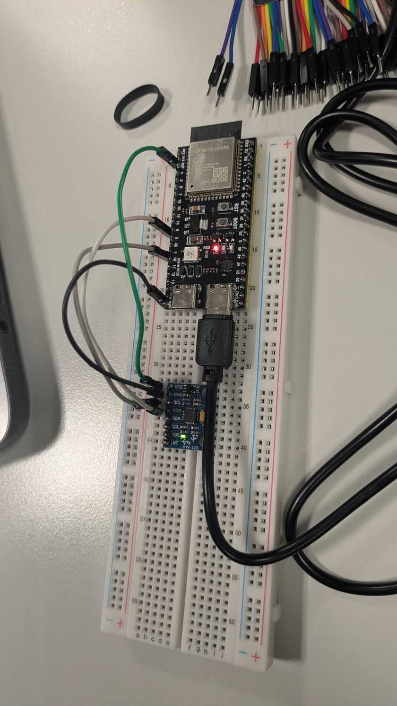

# Real-time AI on a microcontroller — breathing and motion classifier

A wearable-style monitor that runs the whole machine-learning chain on an ESP32-S3: it reads
an **MPU-6050 accelerometer + gyroscope**, extracts features and classifies what is happening
to the board, and drives the board's RGB LED — all on the chip, in real time, with no computer
attached. The same state is also published over Bluetooth Low Energy (a `READ`+`NOTIFY`
characteristic, see [`docs/BLE.md`](docs/BLE.md)); the board's own Wi-Fi status page is the
remaining step and is marked as such below rather than described as working.

Group project for *Computer-Aided Medical Diagnostics (MPA-PRM) — Application IV: real-time AI
applications*, a 4-hour graded lab.

## Group

| Member | GitHub |
| --- | --- |
| Judith Azcona García | [@judithazcona](https://github.com/judithazcona) |
| Mohammed Sami Furqan | [@sami-furqan](https://github.com/sami-furqan) |
| Yaren Ustaosmanoglu | [@yarenuo](https://github.com/yarenuo) |

Course requirement: the teacher **`tomasvicar`** is an accepted collaborator on this repository
(Settings → Collaborators), checked with
`gh api repos/judithazcona/AppII-realtime-edge-devices/collaborators --jq '.[].login'`.

## The four states

One device recognises all four, shown on the RGB LED:

| LED colour | state |
| --- | --- |
| 🟢 green | calm breathing (sensor on the chest) |
| 🔴 red | fast breathing (sensor on the chest) |
| 🔵 blue | not attached (held in the hand, or lying on the table) |
| 🟣 magenta | shaking |

## Hardware

| Part | Role |
| --- | --- |
| ESP32-S3 N16R8 development board | sensing, features, classification, LED, BLE (its own web page: TODO) |
| MPU-6050 (GY-521) module | 3-axis accelerometer + 3-axis gyroscope on I²C |
| Breadboard + jumper wires | wiring |
| USB cable | **power only in the demo** — no data over it, nothing computed on the PC |



*The GY-521 on the breadboard wired to the ESP32-S3 N16R8: `VCC`→`3V3`, `GND`→`GND`,
`SDA`→GPIO 8, `SCL`→GPIO 9, `AD0`/`INT`/`XDA`/`XCL` left unconnected. The pin-by-pin table,
the USB bridge and the measured board settings live in [`HARDWARE.md`](HARDWARE.md).*

## What it looks like when it runs

```
power (USB or power bank) → ESP32-S3 boots on its own → reads MPU-6050 @100 Hz
           → 2.5 s window → 26 features → MLP 26-16-4 on the chip
           → two agreeing windows → RGB LED: green / red / blue / magenta
           → BLE notify (on change + 1 s heartbeat) → monitor page: state, timeline, alarms
           → [TODO] own Wi-Fi hotspot → http://192.168.4.1 : live signal + class probabilities
```

- **Monitoring page (BLE, Web Bluetooth):** _**TODO — no link yet.** Web Bluetooth needs HTTPS, so
  the page must be served from a **second, public GitHub Pages repository**; that repository has
  not been created, so there is no address to put here and inventing one would be a lie. The BLE
  side the page will talk to is done and documented: name `AppII-Monitor`, service
  `53bc7f1a-6719-4a10-917d-11be1aba66a3`, characteristic
  `e8507aa2-f631-4a05-893c-2a781f9d5be3` (`READ`+`NOTIFY`), value = the state string — see
  [`docs/BLE.md`](docs/BLE.md)._
- **Board's own page:** _**TODO** — step 9 of [`PLAN.md`](PLAN.md); the hotspot is not implemented,
  so `http://192.168.4.1` does not answer yet._

## Status, honestly

| | |
| --- | --- |
| Sensor at 100 Hz, 0 read failures | **done, measured** (99.86 Hz over 9243 samples) |
| On-chip features + MLP + LED with ~2 s smoothing | **done**, flash 578 953 B (44 %) / RAM 40 180 B (12 %) |
| BLE `READ`+`NOTIFY` state characteristic, CCCD, heartbeat | **done on the server side**; no browser has been observed receiving it |
| Training pipeline, 4 classes, session-level splits | **done** — held-out test **76.8 %**, see [`docs/RESULTS.md`](docs/RESULTS.md) |
| Wiring photo, build commands, dataset format, this README | **done** |
| GitHub Pages BLE monitor page, board Wi-Fi page, abstention extension | **not implemented** |
| Feature parity chip↔PC, power-bank acceptance test | **not run** — [`docs/TESTING.md`](docs/TESTING.md) §7 |

## Grading

| Part | Points |
| --- | --- |
| Movement vs. shaking | 2.5 |
| Breathing (four states) | 2.5 |
| BLE monitor | 1.5 |
| Web page from the board | 1 |
| Own extension | 1.5 |
| Documentation | 1 |
| **Total** | **10** |

Points count only for what is demonstrated live to the teacher.

## Own extension: knowing when it does not know

Instead of always naming a class, the device **abstains** when it is not sure: below a
confidence threshold, or when the movement is far from anything it was trained on, it reports
*unsure*. The number that matters is accuracy against coverage — what fraction of windows it
answers, how often those are right, and how many of its refusals it would have got wrong. The
measurements land here with step 10 of [`PLAN.md`](PLAN.md).

## Repository layout

| Path | Purpose | Status |
| --- | --- | --- |
| `AGENTS.md` | Working rules, including the two compulsory rules that decide the grade | done |
| `PLAN.md` | States, grading, hard constraints, commit tracker, time plan, demo script, open questions | done |
| [`HARDWARE.md`](HARDWARE.md) | **The truth about the wiring**: pin table, USB bridge, board build settings, what is measured vs assumed — kept in step with `firmware/config.h` | done |
| [`docs/BLE.md`](docs/BLE.md) | Device name, both UUIDs, value encoding, when it notifies, Web Bluetooth snippet | done |
| [`docs/TRAINING.md`](docs/TRAINING.md) | Recording → splitting → 26 features → MLP → exported weights, with the reproduce commands | done |
| [`docs/RESULTS.md`](docs/RESULTS.md) | Dataset, held-out confusion matrices, sizes, and the list of what was never measured | done |
| [`docs/TESTING.md`](docs/TESTING.md) | Verification log: every check, the command, what it printed, PASS / FAIL / NOT RUN | done |
| [`docs/AI_TOOLS.md`](docs/AI_TOOLS.md) | What the AI assistant did, what the group did, the guardrails it worked under | done |
| `docs/wiring.jpg` | The real breadboard photo (EXIF stripped, 93 KB; full-resolution original stays out of the repo) | done |
| `firmware/` | ESP32-S3 firmware: sensor, features, exported model, LED, BLE. [`config.h`](firmware/config.h) holds the pins and the BLE UUIDs; `bench_test`, `led_test`, `data_recorder` are bring-up/collection, `classifier` is the demo, `debug_pipeline` a temporary diagnostic; [`firmware/README.md`](firmware/README.md) the exact build commands | demo sketch compiles clean; flash status in TESTING.md §6 |
| `training/` | `config.py` (shared `SEED`, classes, paths), `record.py`, `features.py`, `train.py` (splits, MLP, weight export), `split_assignment.json` | done |
| [`data/README.md`](data/README.md) | **CSV format, session naming, recording protocol and how to re-record** — the raw recordings themselves stay off the repo (rule 20) | done |

The raw IMU recordings, extracted windows and model binaries are deliberately **not** in this
repository: it is public, and they are large. [`data/README.md`](data/README.md) describes the
CSV format, the session naming and how to re-record a dataset from scratch.

## How to run

**Training and recording (PC).** Python runs through [uv](https://docs.astral.sh/uv/), so there
is no manual virtualenv:

```bash
uv add <package>      # install a dependency (updates pyproject.toml + uv.lock)
uv run <script.py>    # run a script inside the project environment
```

Recording a labelled dataset from the board (the board first runs `firmware/data_recorder`):

```bash
uv run python training/record.py --probe    # 3 s, writes nothing, prints the measured Hz
uv run python training/record.py            # asks for class + session name, counts down, records
uv run python training/record.py --list     # what we have, and which takes still count
```

Training a model and exporting the weights the chip runs (needs the recordings in `data/raw/`,
which are not in this repo — see [`data/README.md`](data/README.md)):

```bash
uv sync                                                     # pyproject.toml + uv.lock
uv run python training/train.py --export                    # all four classes
uv run python training/train.py --classes not_attached,shaking --export
```

Both print held-out **session** accuracy, a per-class confusion matrix and a logistic-regression
floor, and the exporter re-reads `firmware/model_weights.h` and diffs it against scikit-learn
(max |Δp| 1.6e-07) before it exits.

**Firmware (board).** Built with [`arduino-cli`](https://docs.arduino.cc/arduino-cli/) and the
`esp32:esp32` core, Arduino-style C++, with **NimBLE-Arduino** for BLE and Adafruit NeoPixel for
the on-board addressable RGB LED. Everything installs into the user folder, no administrator
rights:

```powershell
arduino-cli core install esp32:esp32                              # 3.3.12
arduino-cli lib install "NimBLE-Arduino" "Adafruit NeoPixel"
$FQBN = "esp32:esp32:esp32s3:FlashMode=dio,FlashSize=16M,PSRAM=disabled,CDCOnBoot=default"
arduino-cli compile --fqbn $FQBN firmware/<sketch>
arduino-cli upload  -p COM4 --fqbn $FQBN firmware/<sketch>
```

[`firmware/README.md`](firmware/README.md) holds the authoritative commands — the FQBN above is
the one every build here uses, with each option marked measured or assumed — and
[`HARDWARE.md`](HARDWARE.md) the pins (I²C on GPIO 8/9, `0x68`, LED on GPIO 48).

Every script sets its random seeds from one shared constant, so re-running a training script on
the same recordings reproduces the same metrics.

## Data and method

12 usable sessions are on disk (4 `not_attached`, 4 `shaking`, 2 `calm_breathing`,
2 `fast_breathing`), recorded by the group with `firmware/data_recorder` + `training/record.py`.
Each recording is one continuous session of a single class; the **train/test split is assigned per
whole session before any windowing** ([`training/split_assignment.json`](training/split_assignment.json)
is committed), so overlapping 2.5 s windows never leak across the split, and metrics are reported
on held-out **sessions**. 26 features per window, `MLP 26-16-4`, seeded with `SEED = 20261109` so
two runs give the same numbers.

Held-out test accuracy **126/164 = 76.8 %** — `shaking` 100 % and `fast_breathing` 100 % recall,
`calm_breathing` 74 %, **`not_attached` only 26 %** (a board in a lap pocket reads as breathing),
and each breathing class is measured on one session of one person, which is weak evidence. The
full confusion matrix, the two-class result and the honest caveats are in
[`docs/RESULTS.md`](docs/RESULTS.md); how to reproduce them is in [`docs/TRAINING.md`](docs/TRAINING.md).

## AI tools used

Allowed under the BUT rules, and we used one tool:

- **Claude Code** (Anthropic's terminal agent), driven interactively by Judith. It wrote the
  `uv`-based recorder, the feature/training scripts, the weight exporter, the firmware sketches,
  the BLE service and these documents, and it did most of the debugging (compiler errors, the
  split-starvation bug, the NimBLE 2.x API changes, the CCCD root cause). Commits it helped with
  carry `Co-Authored-By: Claude Code <noreply@anthropic.com>`, so the history shows which ones.

The group did the wiring and the pin measurement, recorded every session, chose the classes and
colours, set the split policy, and judged the results. The tool worked under the rules in
[`AGENTS.md`](AGENTS.md): no invented pins, no invented metrics, no secrets or raw data in this
public repo, nothing irreversible without asking. [`docs/AI_TOOLS.md`](docs/AI_TOOLS.md) splits
the work stage by stage. Every group member is expected to be able to explain the resulting code,
as the assignment requires.

## Assignments and rules

The assignment sheet ("Real-time AI on a microcontroller", MPA-PRM Application IV) is not
committed here — it is course material and a large download. Its compulsory conditions and
grading are restated at the top of [`AGENTS.md`](AGENTS.md) and [`PLAN.md`](PLAN.md).
